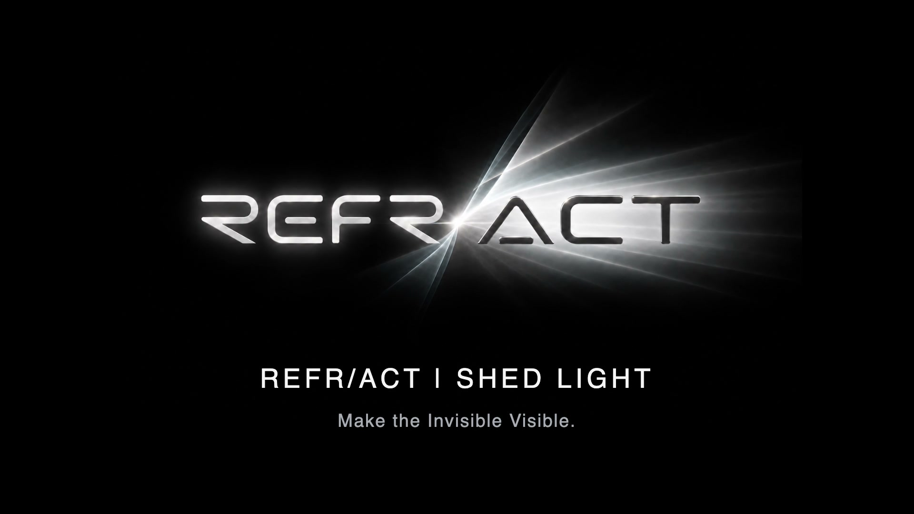

# REFR/ACT — SHED LIGHT

**Make the Invisible Visible.**

**[▶ Watch / download the 30-second teaser](REFRACT-SHED-LIGHT-Teaser.mp4)**

A small light rolls through darkness, finds another, and awakens more. Their paths come together; the light settles into the dot of **i** in *Shed Light* before revealing the original REFR/ACT identity.

30 seconds · 1920 × 1080 · 30 FPS · stereo sound

Created for the proposed **SHED LIGHT — PRISMS House Game Pilot** at Princeton International School of Mathematics and Science. This teaser is a creative concept; event details remain subject to school approval.

---

**中文：** 一颗光点在黑暗中滚落、遇见同伴，逐步唤醒更多光。它们汇聚后，光点落在 *Shed Light* 的 **i** 上，最终揭示 REFR/ACT 标识。点击封面观看 30 秒预告片。
